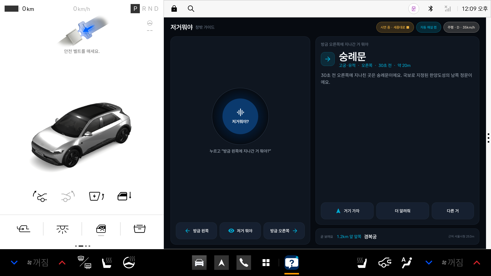
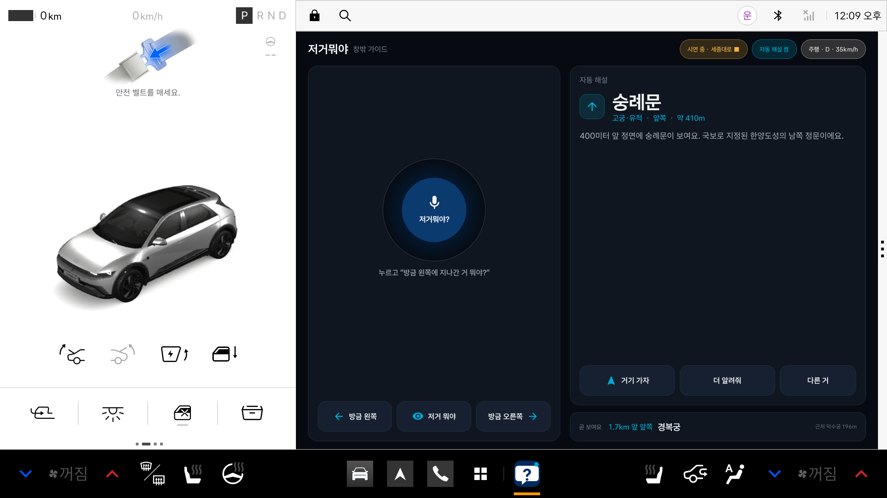
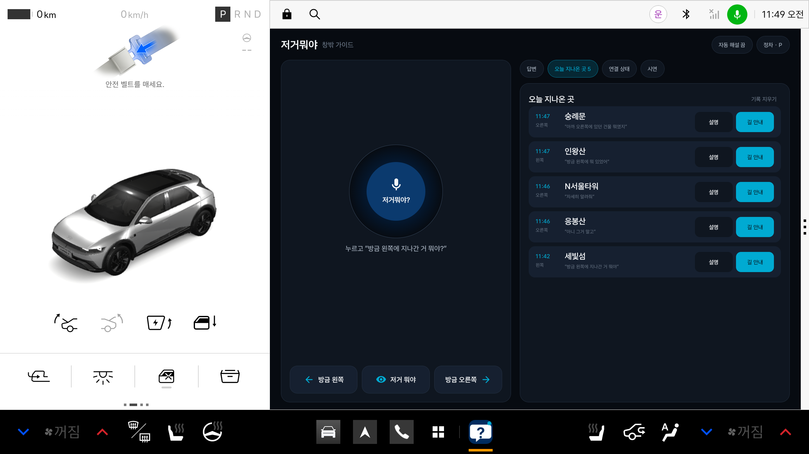

# 저거뭐야 (WhatsThat) — 창밖 가이드

> 운전하다 "방금 저거 뭐야?" 하고 물으면, 차가 이미 지나친 것까지 기억해 대답해 주는 Pleos Connect 앱.

운전 중에는 휴대폰으로 검색할 수 없습니다. 게다가 궁금한 건 대부분 **이미 지나친 뒤**라서 검색어조차 모릅니다.
저거뭐야는 차량의 지나온 궤적과 진행 방향으로 **"방금 왼쪽/오른쪽에 무엇을 지나쳤는지"** 계산하고, 음성으로 바로 답합니다.
"거기 가자"라고 하면 Pleos 내비게이션으로 길 안내까지 이어집니다.

| 주행 중 "방금 오른쪽" 질문 | 자동 해설(정면) | 정차 시 오늘 지나온 곳 |
|---|---|---|
|  |  |  |

## 핵심 기능

| 기능 | 설명 | 사용 SDK / API |
|---|---|---|
| 방금 지나친 것 묻기 | "방금 왼쪽에 지나간 거 뭐야?" → 지나온 궤적의 구간별 최근접점과 진행 방향으로 좌/우·경과 시간을 판정 | FusedLocation, SpeechToText, TextToSpeech |
| 지금 보이는 것 묻기 | "저거 뭐야?" → 진행 방향 시야각 안의 장소 | FusedLocation |
| 거기 가자 / 경유지 | 답한 장소로 목적지 설정, 안내 중이면 경유지 추가 | NaviHelper (`requestRoute`, `addWaypoint`) |
| 자동 해설 | 곧 창밖에 나타날 명소를 먼저 알림. 실차에서는 Proximity Alert 진입 이벤트로 트리거 | FusedLocation (`addProximityAlert`) |
| 운전 부담 인지 | 방향지시등 작동 중엔 먼저 말 걸지 않음, 90km/h 이상·방향지시등 중엔 답을 짧게, 전조등 켜짐 시 야간 멘트 | Vehicle (Gear, TurnSignal, Wiper, Light, Odometer), AAOS `PERF_VEHICLE_SPEED` |
| 주행/정차 UI 전환 | 주행 중엔 음성+큰 버튼 3개만, P단·주행규제 해제 시에만 기록·상세 화면 | Vehicle Gear + AAOS `CarUxRestrictions` |
| 오늘 지나온 곳 | 물어본 장소 기록, 정차 중 설명 듣기·길 안내 | 로컬 저장 (외부 전송 없음) |

## 실행 방법

### 1) 개발 환경
- Android Studio (또는 command-line tools), Android SDK 34, JDK 17, Gradle 8.9 (wrapper 포함)
- Pleos Connect Emulator v2.1.0 (API 34, Automotive) — [설치 가이드](https://document.pleos.ai/docs/connect/guide/getting-started/application-development/setup-connect-sdk-emulator)
  - AVD 부팅 옵션은 **Cold boot** (VHAL 사용), RAM 4GB
  - 음성 질문을 쓰려면 Extended Controls → Microphone → **Virtual microphone uses host audio input** 켜기

### 2) 빌드·설치
```bash
./gradlew :app:assembleDebug
adb install -r -g app/build/outputs/apk/debug/app-debug.apk
```
또는 배포용 APK를 바로 설치: `adb install -r -g apk/WhatsThat_저거뭐야_release.apk`

`-g` 는 위치(`pleos.car.permission.FUSED_LOCATION`)·차속 권한을 미리 허용합니다. 없으면 첫 실행 때 동의 창이 뜹니다.

### 3) (선택) 서버형 음성 사용
Pleos Playground My Project의 클라이언트 ID/시크릿을 `local.properties`에 넣으면 TTS/STT가 HYBRID(서버 우선) 모드로 동작합니다. 비우면 ON_DEVICE 엔진을 씁니다.
```properties
pleos.clientId=...
pleos.clientSecret=...
```

## 테스트 환경과 시연 방법

| 방법 | 거치는 경로 | 용도 |
|---|---|---|
| **앱 안 시연 모드** (정차 → `시연` 탭 → 올림픽대로/세종대로/경부고속도로 `출발`) | 앱 내부 위치 재생(3배속), 기어 D 표시 | PT·전시장에서 외부 도구 없이 시연 |
| **실제 SDK 경로 시연** | 에뮬레이터 GPS → Pleos FusedLocation SDK → 앱 | 실제 연동 검증 |

실제 SDK 경로 시연:
```bash
adb forward tcp:8088 tcp:8088          # Pleos Connect Virtual Console → http://127.0.0.1:8088 에서 Gear D
python3 scripts/drive_route.py olympic --speed 70 --scale 3
```

디버그 빌드에서는 음성 인식 결과를 adb로 주입해 음성 명령 전체 흐름을 확인할 수 있습니다:
```bash
adb shell "am broadcast -a io.whatsthat.car.DEBUG_ASK --es q '방금 왼쪽에 지나간 거 뭐야'"
```

### 검증 결과 (Pleos Connect Emulator v2.1.0)
- Vehicle·FusedLocation·NaviHelper·TextToSpeech·SpeechToText 5종 모두 Pleos SDK로 연결 (`연결 상태` 탭에서 확인)
- Virtual Console 기어 P↔D 전환이 앱의 주행/정차 UI에 반영
- 올림픽대로 실주행 재생: "방금 왼쪽" → 세빛섬, 자동 해설 "1.5km 앞 오른쪽 잠실 올림픽주경기장", "거기 가자" → Pleos 내비 경로 탐색
- 세종대로: 숭례문(오른쪽)·덕수궁(왼쪽)·인왕산(왼쪽)·"아까 오른쪽"(80초 전 숭례문)
- 단위 테스트 15개 통과: `./gradlew :app:testDebugUnitTest` (좌/우 판정, 시간 창, 순간이동 궤적 초기화, 정면 판정, 먼 명소·근접 우선, 질의 해석, 한국어 조사)
- 에뮬레이터 미지원 속성(트립 거리)은 오류 없이 상태 패널에 "미지원"으로 표시

## 구조

```
app/src/main/java/io/whatsthat/car/
├─ domain/     순수 로직 (안드로이드 의존 없음, 단위 테스트 대상)
│   ├─ SightingResolver   지나친/보이는/곧 보일 장소 판정
│   ├─ Trajectory         최근 30분 궤적 링버퍼 (GPS 튐 시 초기화)
│   ├─ QueryParser        한국어 음성 질의 → 명령
│   └─ Narrator           답변 문장, 주행 부담에 따른 길이 조절, 조사 처리
├─ platform/   Pleos SDK·AAOS 어댑터 (SDK 미지원 시 대체 경로)
│   ├─ LocationProvider   FusedLocation + Proximity Alert (→ AAOS LocationManager 대체)
│   ├─ VehicleMonitor     Vehicle SDK + CarUxRestrictions + PERF_VEHICLE_SPEED
│   ├─ VoiceInput/Output  SpeechToText / TextToSpeech (ON_DEVICE · HYBRID)
│   └─ NaviBridge         NaviHelper 목적지·경유지
├─ data/       내장 장소 데이터(assets/landmarks.json), 오늘 지나온 곳 저장
├─ demo/       시연 경로 재생
└─ ui/         Compose UI (현대차 브랜드 톤 다크 테마), ViewModel
```

## 개인정보
위치·차속은 기기 안에서 "지나친 장소" 계산에만 쓰고 외부로 보내지 않습니다. 기록은 최근 100건만 기기에 저장하며, 정차 화면에서 지울 수 있습니다.

## APK
`apk/WhatsThat_저거뭐야_release.apk` (release 서명, R8 최적화)
